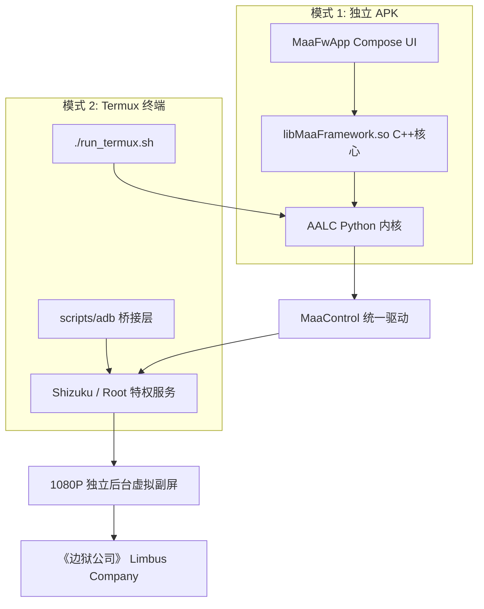

# AhabAssistantLimbusCompany-Android (AALC 安卓版)

基于 [MaaFramework](https://github.com/MaaXYZ/MaaFramework) 与 [MaaFwApp](https://github.com/Aliothmoon/MaaFwApp) 构建的《边狱公司》安卓原生自动化工具。彻底脱离电脑与模拟器，在手机上原生运行，支持 1080P 后台独立虚拟副屏免打扰挂机。

---

## 两种运行与部署方式

本项目支持 **独立 APK 应用（普通用户推荐）** 与 **Termux 终端极客模式（开发者/免安装）** 两种运行形态：

### 方式 1：安装独立 APK（推荐）
1. 前往本仓库 [Releases](../../releases) 页面，下载最新的 `AALC-Android-Release.apk` 并安装。
2. 打开手机里的 **Shizuku**（支持无线调试或已 Root 授权）。
3. 打开 AALC 边狱助手 App，允许 Shizuku 授权。
4. 勾选需要的任务（如「一键长草」），展开卡片设置次数与编队。
5. 点击右下角「开始」。游戏会在后台 1080P 独立虚拟副屏运行，不遮挡前台操作，可点悬浮窗查看实时画面。

---

### 方式 2：在 Termux 终端中直接运行（免 APK）

针对 Termux 做了完整的本机适配与 **ADB 欺骗桥接层 (`scripts/adb`)**，手机本机无需开启无线调试或连接电脑：

#### 1. 准备环境
在 Termux 中安装依赖：
```bash
pkg install -y python git opencv-python d8
pip install ruamel.yaml pillow colorlog onnxruntime
```

#### 2. 克隆本仓库并一键运行
```bash
git clone https://github.com/DeconstructedCube/AhabAssistantLimbusCompany-Android.git
cd AhabAssistantLimbusCompany-Android

# 一键启动全自动长草 (自动挂载 1080P 副屏与 ADB 桥接)
./run_termux.sh

# 或指定运行特定任务：
./run_termux.sh --task mirror_dungeon        # 仅全自动镜牢
./run_termux.sh --task exp_luxcavation       # 仅经验本采光
./run_termux.sh --task thread_luxcavation    # 仅纽本采光
./run_termux.sh --task infinite_battle_tool  # 亚哈降神附身代打 (主线/轨道无限自动战斗)
./run_termux.sh --task production_module_tool # 仅定时自动换饼
```

#### 3. Termux ADB 桥接层说明
- 手机本地通常没有运行网络 ADB daemon，原版脚本如果直接连 `127.0.0.1:5555` 会拒绝连接。
- 本项目内置了 **`scripts/adb`** 与 **`ShizukuDeviceProxy`**：
  - 自动将所有 `adb devices`、`adb shell`、`adb screencap` 调用拦截并无缝转译为本机 **Shizuku 特权 IPC (`~/rish`)**；
  - 数据与截图通过系统内存和 `/sdcard/Download/` 高速交换；
  - 欺骗任何依赖 ADB 的旧代码，在手机内部实现 0 端口监听、0 无线调试的全速原生运行！

---

## 功能清单

- **日常长草**：
  - 经验采光：自动进入最高关卡战斗，支持连续战斗、按星期自动换队及 0 次单独跳过。
  - 纽本采光：自动进入对应星期纽本，支持连续战斗、按星期自动换队及 0 次单独跳过。
  - 脑啡肽换体：自动合成模块，支持设定狂气买体次数及葛朗台卡点买体。
  - 领取奖励：自动收取通行证任务经验与邮箱附件。
- **全自动镜牢**：
  - 10 大体系选择、多队伍轮换队列、编队码导入、保持游戏内原有罪人顺位或 1~12 全席位自由编排；
  - 开局星光加成点选、初始自选饰品（支持跨体系与优先级顺序）与定向观测 E.G.O 饰品；
  - 楼层候选主题包 OCR 识别与自定义权重、第 5 层活动卡包优先/跳过策略；
  - 基于 YOLOv8 深度学习模型的地图节点识别与最优路径寻路；
  - 商店四级优先激进合成、第二体系完整配置、细粒度购买/舍弃/禁令策略、饰品升级与全模式技能替换；
  - 自动拼刀、移动端原生触控胜率出招、3 技能优选/规避、小指良单通连续守备、困难周常自动切换与单次加成消耗。
- **便民工具**：
  - 亚哈代打（无限自动战斗）：主线推图与折射轨道自动接管战斗与异想体判定事件；
  - 定时换饼：OCR 监控当前脑啡肽与回复倒计时，满 20 体力自动上线合成模块，支持休眠期杀后台省电。
---

## 架构简图



---

## 许可证

本项目遵循 **AGPL-3.0** 开源许可证。
- MaaFramework: LGPL-3.0
- MaaFwApp: AGPL-3.0
- AhabAssistantLimbusCompany: AGPL-3.0
